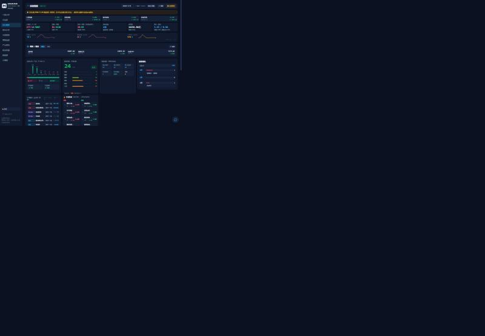
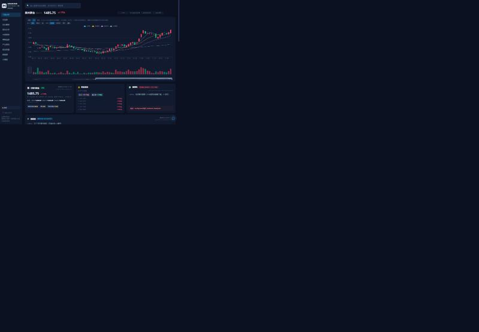
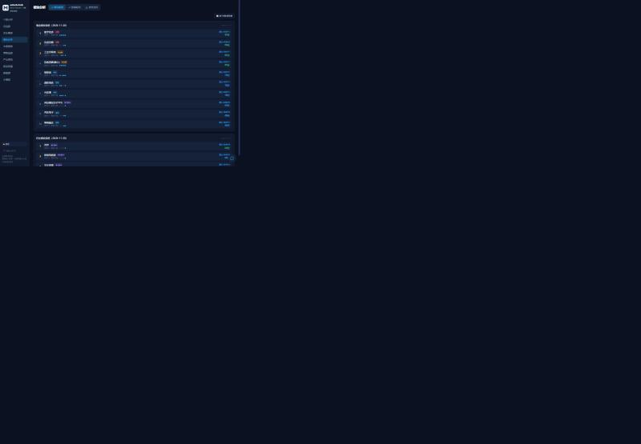
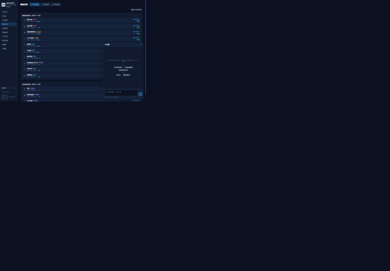
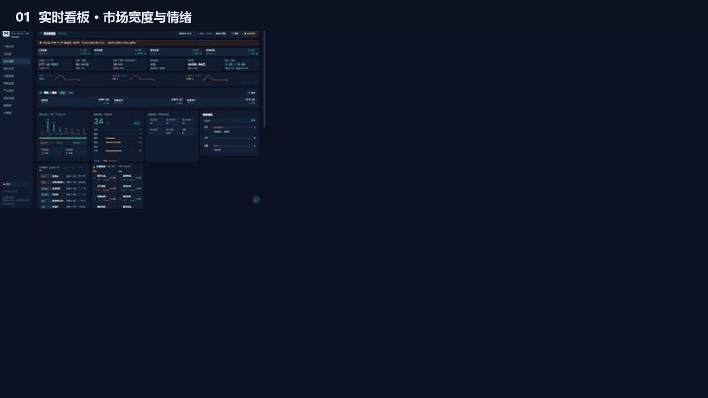

<p align="center"><b>简体中文</b> | <a href="README_EN.md">English</a></p>

<h1 align="center">astock-hub</h1>

<p align="center">
  <b>可自托管的 A 股数据聚合与 AI 研究面板</b><br>
  实时看板 · 个股分析 · 板块轮动 · 大盘复盘 · 策略选股 · 产业资讯 · 可选 AI 问答
</p>

<p align="center">
  系统显示名称：<b>Mind AShare</b>；仓库、Python 包和命令行仍使用 <code>astock-hub</code>
</p>

<p align="center">
  <a href="LICENSE"></a>
  
  
  
  
</p>

---

<p align="center">
  <a href="#界面预览">界面预览</a> ·
  <a href="#功能">功能</a> ·
  <a href="#数据与市场">数据</a> ·
  <a href="#支持的-ai">支持的 AI</a> ·
  <a href="#快速开始">快速开始</a> ·
  <a href="#安全与隐私">隐私</a> ·
  <a href="#当前边界">边界</a> ·
  <a href="#开发与测试">开发</a>
</p>

`astock-hub` 将市场行情、个股研究、板块结构、产业资讯和可选 AI 辅助放进同一个本地 Web 面板。程序运行在自己的电脑或服务器上，数据文件、模型配置和通知密钥由使用者自己管理。

- **一个面板完成日常查看**：先看指数、市场宽度、成交额和情绪，再下钻到板块与个股。
- **自托管**：无需注册官方账号，不上传配置文件；默认只监听本机地址。
- **基础功能直接体验**：个股公开行情和 K 线无需密钥即可查询，全市场统计可接入本地历史数据。
- **AI 可选而非必需**：没有模型 Key 也能使用基础面板；接入自己的模型后，再启用问答、摘要和研究辅助。
- **数据能力可扩展**：支持公开接口、本地 Parquet 数据及可选的专业数据服务，单路异常时结构化降级。
- **桌面与手机浏览器共用一套页面**：局域网访问由使用者显式开启。

## 界面预览



<table>
<tr>
<td width="50%" valign="top"><br><b>个股分析</b>：日 K、技术指标、估值、资金流与信息面</td>
<td width="50%" valign="top"><br><b>板块分析</b>：主线、次主线与板块轮动结构</td>
</tr>
<tr>
<td width="50%" valign="top"><br><b>AI 问答</b>：按页面提问，模型由使用者自行接入</td>
<td width="50%" valign="top"><a href="docs/images/overview.gif"></a><br><b>功能速览</b>：看板、个股、板块与 AI 问答</td>
</tr>
</table>

截图拍摄于 2026-11-20，来自 astock-hub 的真实运行页面；未使用真实账户、密钥或私有资料，AI 截图未生成投资结论。详见[界面素材说明](docs/images/README.md)。

## 功能

| 栏目 | 可以做什么 |
|------|------------|
| **实时看板** | 查看指数、市场宽度、涨跌分布、成交额、情绪、涨停梯队、主线与全球指数；支持按交易日回看 |
| **个股分析** | 查询分时与日 K、技术指标、估值、资金流、龙虎榜、业绩预告、研报与关键价位 |
| **板块分析** | 查看主线轮动、涨幅矩阵、板块成分及阶段表现 |
| **大盘复盘** | 基于市场数据生成复盘内容，保存并回看历史报告；生成式复盘需要模型配置 |
| **策略选股** | 使用内置技术条件扫描本地全市场数据，查看评分与近 20 日走势；只做筛选，不给买卖建议 |
| **产业资讯** | 按赛道浏览全球产业新闻，检索新闻详情，可选 AI 中文摘要 |
| **自选股与提醒** | 分组管理自选股，按需配置通知渠道和提醒规则 |
| **数据源与大模型** | 在页面上保存自己的服务配置、测试连接，不手工修改密钥文件 |
| **AI 问答** | 围绕当前页面和系统数据提问；回答标注所用数据块与基准日期 |

> 全市场看板、情绪、主线和策略扫描依赖本地历史数据；首次使用请按[安装指南](docs/INSTALL.md)初始化。基础个股行情与 K 线可先直接体验。

## 数据与市场

| 数据类型 | 接入方式 | 主要用途 |
|----------|----------|----------|
| 公开行情接口 | 无需 Key | A 股个股、指数、K 线、分时及全球指数 |
| 公开产业资讯 | 内置 RSS 源清单 | 产业新闻聚合与检索 |
| 本地历史数据 | 自行初始化或提供 Parquet 文件 | 全市场宽度、情绪、主线和策略扫描 |
| hithink-finance | 自行安装并授权 CLI | 历史数据维护与补充行情 |
| Tushare / TickFlow | 在「数据源」页填写自己的凭证 | 当前版本已接入的相应数据接口 |
| TdxQuant | 在「数据源」页填写自己的凭证 | 凭证管理与连接探测，实际路由以当前版本为准 |
| 用户自有纪要报告 | 配置自己已获授权的本地目录 | 信息面检索；仓库不附带纪要内容 |

- 市场覆盖以 **A 股和全球指数**为主；其他市场个股取决于所接入的数据服务。
- 保存凭证不代表该服务的所有接口都已接入，实际范围以当前代码与[数据接入说明](docs/DATA_SOURCES.md)为准。
- 免费接口也可能限流、延迟或暂时不可用；重要数据需要独立核实。
- **代码许可不等于数据授权**，数据的保存、展示、商用和二次分发由使用者自行确认上游条款。

## 支持的 AI

AI 功能完全可选。未接入模型时，仍可浏览行情、图表和本地数据。

| 接入方式 | 需要准备 | 用途 |
|----------|----------|------|
| Claude 订阅命令行 | 本机安装支持的 Claude CLI，并使用自己的订阅登录 | 可用的对话与研究辅助 |
| OpenAI 兼容模型 API | 自行准备接口地址、模型名和 Key | AI 问答、资讯摘要、复盘与研究辅助 |
| 外部 TradingAgents 环境（可选） | 自行部署对应项目及模型配置 | 个股多 Agent 深度分析 |

- 页面提供若干模型供应商预设；**预设不等于已完成兼容性认证**，请以「测试连接」结果为准。
- 产品不附赠模型订阅或调用额度，使用自己的服务会产生相应费用。
- AI 输出只作为研究辅助；基础面板不依赖模型，也不会因模型不可用而伪造结果。
- 详细配置见[安装指南](docs/INSTALL.md)与[数据接入说明](docs/DATA_SOURCES.md)。

## 快速开始

### 环境要求

| 项目 | 要求 |
|------|------|
| 操作系统 | Windows 10/11、macOS 或 Linux；当前已实测 Windows，其他系统按同一路径安装、待对应验收 |
| Python | 3.11 或更高版本 |
| Node.js | 18 或更高版本，包含 npm |
| AI | 可选；一键安装不会安装模型 CLI 或订阅 |
| Docker | 当前未提供官方 Dockerfile 或镜像 |

### 一键安装

先安装一次 Python 和 Node.js，然后：

**Windows**

双击项目根目录的 **`install.cmd`**，自动安装、启动并打开浏览器。

也可以在 PowerShell 中执行：

```powershell
powershell -ExecutionPolicy Bypass -File install.ps1 -Start
```

**macOS / Linux**

```bash
bash install.sh --start
```

一键脚本会创建 `.venv`、安装后端与前端依赖、构建页面；加上启动参数后启动面板。重复执行会复用现有虚拟环境。

只需安装、暂不启动：

- Windows：`powershell -ExecutionPolicy Bypass -File install.ps1`
- macOS / Linux：`bash install.sh`

安装完成后打开 **http://127.0.0.1:8756**。

### 手动安装与不同系统

完整的分步命令按系统分别整理：

- [Windows 10 / 11](docs/INSTALL.md#一windows-10--11)
- [Ubuntu / Debian](docs/INSTALL.md#二ubuntu--debian)
- [macOS（Intel / Apple Silicon）](docs/INSTALL.md#三macosintel--apple-silicon)
- [Fedora / Arch](docs/INSTALL.md#四其他-linux)
- [云服务器与 SSH 安全访问](docs/INSTALL.md#五云服务器安装与安全访问)
- [手机、平板与局域网访问](docs/INSTALL.md#六手机平板和局域网访问)

### 初始化全市场数据（按需）

基础个股查询可以先使用。全市场看板、主线、情绪和策略扫描需要本地历史数据：

```bash
hithink-finance data init
hithink-finance data sync
```

也可以放入自己已有的 Parquet 数据。初始化时间取决于数据源和网络；详见[安装指南](docs/INSTALL.md#七初始化全市场数据按需)。

## 安全与隐私

- 默认监听 `127.0.0.1`，只允许本机访问。
- 当前采用**机主单用户模式，无内置访问控制**，不要直接暴露到公网。
- 手机或局域网访问须显式设置 `ASTOCK_HUB_HOST=0.0.0.0`，并仅对可信局域网放行。
- 公网部署必须自行增加 HTTPS、身份认证、访问控制和速率限制；也可以使用文档中的 SSH 隧道。
- 模型 Key、Webhook、配置文件和运行数据不进入 Git；`config.toml`、`.env`、`data/` 已在 `.gitignore` 中排除。
- 使用在线模型时，发送给模型的内容会离开本机；不要提交私有纪要、账户信息或含令牌的网址。
- 本地保存不等于全程离线，第三方接口和模型服务商的数据政策由使用者自行确认。

## 当前边界

- 本仓库聚焦**数据聚合、市场面板和可选 AI 辅助**，不包含模拟盘、全链路回测、实盘交易、私有资料库及完整策略决策模块。
- 内置技术条件选股只是数据筛选，不构成买卖建议。
- Windows 已完成安装和主要页面验证；macOS、Linux、ARM、NAS 等环境需在对应系统继续验收。
- 当前未提供免安装压缩包、官方 Docker 镜像或公共在线演示。
- 不同数据源的接入深度不同；第三方接口可能变更，未配置的数据会如实显示不可用。
- 本软件不构成投资建议，不承诺收益，也不提供荐股或代客理财服务。

## 开发与测试

### 工作方式

```text
浏览器（桌面 / 手机）
        │  同一套 /api 接口
        ▼
FastAPI 后端
        ├─ 市场、个股、板块与资讯适配器
        ├─ 本地指标与历史数据计算
        ├─ 可选 AI 通道（用户自己的配置）
        └─ 托管 frontend/dist 前端产物
```

### 项目结构

| 路径 | 作用 |
|------|------|
| `astock_hub/` | Python 后端、数据适配器、指标计算与 Web API |
| `frontend/` | React + Vite 页面，构建后由后端统一托管 |
| `docs/` | 安装、数据接入、发布设置与界面素材 |
| `scripts/` | 启动、维护与文档图片生成工具 |
| `tests/` | 启动、功能边界和文档完整性冒烟测试 |
| `install.cmd` / `install.ps1` / `install.sh` | 一键安装入口 |
| `data/` | 本地运行数据，默认不进入 Git |

### 回归检查

Windows PowerShell：

```powershell
.venv\Scripts\python.exe -m pytest tests -q
npm --prefix frontend run build
```

macOS / Linux：

```bash
.venv/bin/python -m pytest tests -q
npm --prefix frontend run build
```

2026-11-20 Windows 验证记录：**6 项冒烟测试通过**，前端生产构建通过；主要个股、看板、板块、策略选股与资讯接口完成检查。此记录不代表其他操作系统或所有外部数据服务均已完成验收。

## 免责声明

本项目仅供学习、研究和信息整理。所有输出均不构成投资建议，不承诺任何收益。第三方公开数据可能延迟、缺失或有误，使用者应自行核实并承担决策责任，同时遵守各数据源和模型服务商的使用条款。

## License

本仓库采用 [MIT License](LICENSE)。第三方组件与许可声明见 [THIRD_PARTY_NOTICES.md](THIRD_PARTY_NOTICES.md)。
