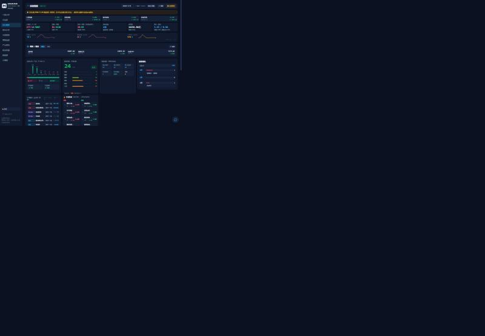
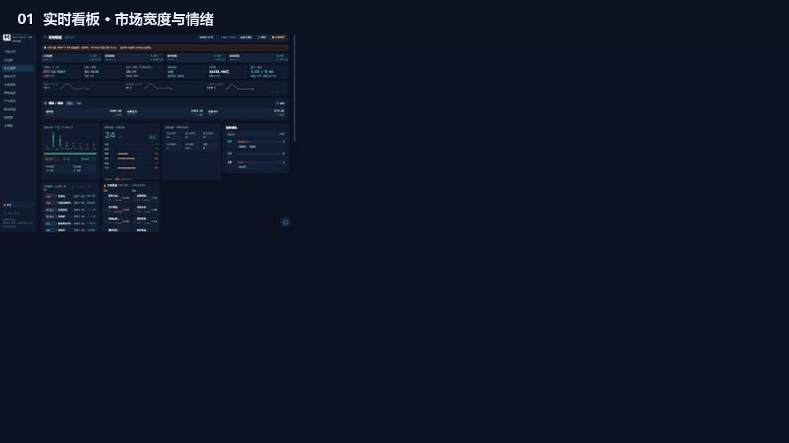

# astock-hub

**A self-hosted A-share market data and AI-assisted research dashboard.**

The UI uses **Mind AShare** as the system display name. The repository, Python package, and CLI remain `astock-hub`.

[](LICENSE)
[](https://www.python.org/)

[中文完整文档](README.md) · [Installation](docs/INSTALL.md) · [Data sources](docs/DATA_SOURCES.md)





## Highlights

- **Self-hosted:** run locally or on your own server; keys and runtime data stay outside Git.
- **Market overview:** indices, breadth, limit-up/down statistics, turnover, sentiment, and sector structure.
- **Stock research:** intraday and daily charts, technical indicators, valuation, capital flow, reports, and key price levels.
- **Sector and strategy views:** rotation, performance matrices, and built-in technical screens over local market data.
- **Optional AI:** connect your own model for data-grounded chat, summaries, and review assistance.
- **Responsive UI:** one web interface for desktop and mobile browsers.

## Quick start

### One-command setup

Install Python 3.11+ and Node.js 18+ once, then:

- **Windows:** double-click `install.cmd` to install, start the panel, and open the browser.
- **Linux / macOS:** run `bash install.sh --start`.

To install without starting, use `install.ps1` on Windows or `bash install.sh` on Linux/macOS.

### Manual setup

Requirements: Python 3.11+, Node.js 18+, and npm.

```bash
python3 -m venv .venv
.venv/bin/python -m pip install -e ".[web]"
npm --prefix frontend ci
npm --prefix frontend run build
.venv/bin/python -m uvicorn astock_hub.webapi:app --host 127.0.0.1 --port 8756
```

Open **http://127.0.0.1:8756**.

On Windows, use `.venv\Scripts\python.exe` instead of `.venv/bin/python`.

Basic stock quotes and charts can be explored first. Full-market dashboards and technical screens require local historical data; see the [installation guide](docs/INSTALL.md).

## Data and AI

Public interfaces cover basic quotes and charts. Optional paid services, local historical datasets, and model providers are configured by the user. Credentials are never bundled.

**Code licensing does not grant data redistribution rights.** Review each provider's terms before storing, sharing, or commercially using data.

## Security and scope

This application uses a **single-owner model without built-in access control**. It listens on `127.0.0.1` by default. Do not expose it directly to the public internet; add HTTPS and authentication for any public deployment.

Backtesting, paper-trading decision chains, live trading, private document pools, and private strategy modules are outside the current repository's scope.

## Acknowledgements

We thank the following projects, authors, and contributors for their code, data interfaces, and research ideas:

- **a-stock-data** — Simon Lin (simonlin1212) and contributors.
- **tick-stock-panel** — shy3130 and contributors.
- **TradingAgents-astock** — Simon Lin and contributors, together with the upstream TauricResearch/TradingAgents authors.
- **National Team Position Estimation** — the project authors and maintainers, for the broad-based ETF share methodology used to observe national-team fund flows.
- **investment-news** — Simon Lin and contributors, for the global industry-news pipeline and curation approach.

Code licensing does not grant data redistribution rights. Provider terms still apply.

## License and disclaimer

MIT licensed. See [LICENSE](LICENSE) and [THIRD_PARTY_NOTICES.md](THIRD_PARTY_NOTICES.md).

For research and information organization only. Nothing in this software constitutes investment advice or a return guarantee. Third-party data may be delayed, incomplete, or inaccurate; verify important information independently.
